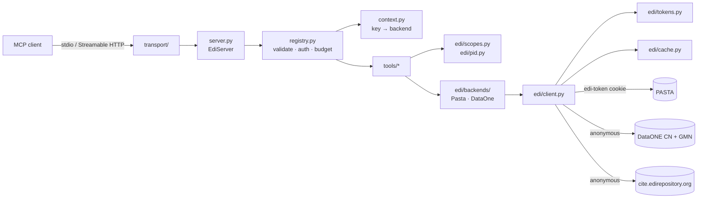

# Architecture

edi-mcp copies the architecture of its sibling
[neon-mcp](https://github.com/idss-mesa/neon-mcp){target=_blank}: one SDK-coupled
adapter, an SDK-independent tool registry, handlers that return pydantic models,
and one upstream HTTP client. What is new is the backend layer: every tool call
is served by PASTA when it has an EDI API key and by DataONE when it does not.

## Request flow

1. **Transport.** stdio, or stateless Streamable HTTP at `/mcp`, where a raw ASGI
   middleware assigns a request id and exposes the request headers (with
   `X-EDI-Key` removed unless the TLS gate allows it) through context variables.
2. **Adapter.** `server.py` is the only module that imports the MCP SDK. It
   serves `tools/list` (sorted, JSON Schema 2020-12, cache hints) and turns a
   `tools/call` into a registry invocation, returning compact JSON text,
   `structuredContent` and `io.edi-mcp/*` `_meta`.
3. **Context.** `build_tool_context` resolves the call's key (`resolve_key` in
   `edi/auth.py`: the configured key on stdio; the caller's header key, or the
   operator key when sharing is enabled, over HTTP). `ctx.backend` is `pasta`
   with a key and `dataone` without.
4. **Registry.** `invoke` validates the arguments against the tool's input
   model, fails fast with `auth_required` for `requires_key` tools when there is
   no key, runs the handler, dumps the output model (camelCase, `None`
   omitted), stamps a default `source`, and enforces the result budget.
5. **Tool.** A handler is `async (args, ctx) -> OutputModel`. It resolves scopes
   and package references (`resolve_scope`, `resolve_reference`, or
   `resolve_package`) and calls `backend_for(ctx)`; it never calls the HTTP
   client directly.
6. **Backend.** `PastaBackend` and `DataOneBackend` implement one contract and
   return the same plain dataclasses, so tools do not branch on the backend.
   Each records its upstream calls in the call's `UpstreamStats` and adds its
   caveats to `notes`.
7. **Client.** `EdiClient` attaches credentials to PASTA requests only, retries,
   follows allow-listed redirects by hand, caps body sizes and caches responses.

## Result budget

Every tool result is measured as compact JSON. Above
`limits.max_result_bytes` (default 50 000), `fit_to_budget` trims the output
model's declared `budget_list` (eliding URL-like fields first, when the model
names them), marks the page `truncated` with `truncatedReason: budget` and a
`nextOffset`, and adds a note. A result still above
`limits.hard_max_result_bytes` (default 200 000) fails with `result_too_large`.

## Module map

| Module | Role |
| --- | --- |
| `__main__.py` | CLI: flags → config → logging → serve; `--check` (offline config check and in-process `edi_ping`), `--print-config` (key redacted) |
| `config.py` | pydantic settings; flag > `EDI_MCP_*` env > YAML > defaults; the key from `EDI_API_KEY` or `EDI_MCP_EDI__API_KEY` |
| `server.py` | the SDK adapter: tools, resources, cache hints, MRTR, upstream `_meta` |
| `registry.py` | `@register_tool` and its checks, argument validation, fail-fast `auth_required`, `fit_to_budget`, the `requestState` codec |
| `context.py` | `ToolContext` (config, key, backend, stats); request-scoped context variables |
| `errors.py` | `ToolError` codes and the upstream error mapping (`upstream_forbidden`, `access_restricted`, …) |
| `logging.py` | structlog to stderr; credential masking and registered-secret redaction |
| `instructions.py` | server instructions returned by `server/discover` |
| `resources.py`, `resources_static/` | `edi://` guides (`agent-workflow`, `api-key`, `citing-edi-data`, `package-identifiers`, `search-syntax`), the dated scope snapshot `scopes.json`, and the `edi://packages/{packageId}[/eml]` templates |
| `prompts.py` | the prompts `edi_find_data`, `edi_cite_package` and `edi_plan_download` |
| `models/common.py` | `EdiInput`, `ToolResultBase`, `Page`, `Resolved`, `Source` |
| `edi/auth.py` | `ApiKey`, per-call key resolution, the HTTP TLS gate, `scrub_url` |
| `edi/tokens.py` | key → `edi-token` exchange and refresh per key identity, `?key=` fallback |
| `edi/client.py` | the one `httpx` client: PASTA-only credentials, cookie jar that stores nothing, retries, allow-listed redirects, byte caps, upstream error scrubbing; `get()` for cached bodies and `stream()` for previews and downloads, both through one redirect loop (`_open`) |
| `edi/cache.py` | per-family TTL cache with single-flight and stale-if-error; PASTA entries keyed by key identity |
| `edi/backends/` | the `Backend` contract, `PastaBackend`, `DataOneBackend`, `backend_for`, `resolve_package` |
| `edi/pid.py` | package identifier, DOI and URL parsing |
| `edi/scopes.py` | scope snapshot, scope names, LTER site codes and `name.identifier` references |
| `edi/xml.py`, `edi/eml.py` | defusedxml parsing and EML prose; EML data-entity references and sizes |
| `edi/preview.py` | delimited-text preview: EML delimiter unescaping, header detection, early-stop record handling |
| `edi/downloads.py` | the download area: confined destinations, safe names, plan caps, `.part` streaming with SHA-1 and exclusive (never-overwrite) placement |
| `projections/eml.py` | parsed EML → compact, capped models (people, coverage, methods, license, project, entities and attributes), with `<references>` resolution |
| `projections/report.py` | PASTA quality report → counts by status and the capped non-valid checks |
| `tools/` | one module per family (`core.py`, `discovery.py`, `packages.py`, which fetches and parses the EML once per call via `load()`; `data.py` for previews and downloads, `citation.py`, `provenance.py` for quality reports and lineage, `feeds.py` for the change feed and read counts), plus helpers in `_common.py` (`source`, `paginate`, `portal_url`) |
| `transport/` | stdio; stateless Streamable HTTP with `/healthz`, `/readyz` and the request-context middleware |

Packaging: `pyproject.toml` builds the `edi-pasta-mcp` wheel, `server.json` is the MCP
Registry entry, the `Dockerfile` the HTTP image, and `.github/workflows/release.yml`
publishes a `v*` tag to PyPI, GitHub releases and the registry.

Design decisions and their reasons are recorded in `DESIGN.md` (the D-numbers)
and verified API facts in `RESEARCH.md`, both at the repository root.
